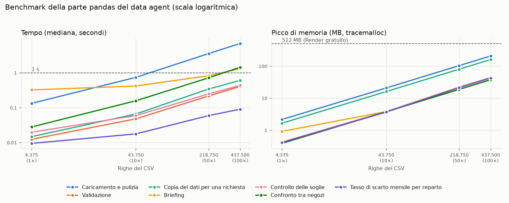

# Benchmark delle prestazioni (parte pandas del data agent)

Generato da `data_agent/benchmark/benchmark.py` il 13/11/2026 alle 23:04, in 3,5 minuti. Nessuna chiamata a OpenAI: si misura solo la parte pandas.

## Come sono fatti i dataset

`data/dati_negozi.csv` duplicato 1, 10, 50 e 100 volte. Ogni copia ha negozi nuovi (copia 2: NEG07–NEG12, copia 3: NEG13–NEG18, ...) e le stesse date, e resta sporca come l'originale (nomi dei negozi incoerenti, tre formati di data, duplicati), così la pulizia lavora davvero. La validazione usa gli stessi controlli del data agent, con l'elenco dei negozi ammessi esteso a quelli generati.

Tempo: mediana di 5 ripetizioni, fatte a rotazione su tutte le dimensioni (così un cambio di velocità della CPU durante la misura colpisce tutte le dimensioni allo stesso modo). Memoria: picco misurato con `tracemalloc` in un'esecuzione a parte (la memoria allocata durante l'operazione). Le operazioni dopo la copia lavorano sulla copia per la richiesta, come nel servizio, con lo scenario "tranquilla" (oggi 1/9/2026, NEG01; soglie sulla settimana 24–30 agosto, confronto su agosto 2026).

| Dimensione | Righe del CSV | Righe dopo la pulizia | Negozi | DataFrame pulito | Dati in bytes (pickle) |
|---|---:|---:|---:|---:|---:|
| 1× | 4.375 | 4.332 | 6 | 1,0 MB | 0,6 MB |
| 10× | 43.750 | 43.320 | 60 | 10,2 MB | 6,2 MB |
| 50× | 218.750 | 216.600 | 300 | 51,3 MB | 31,3 MB |
| 100× | 437.500 | 433.200 | 600 | 102,8 MB | 62,7 MB |

## Sistema

- PC: ASUSTeK COMPUTER INC. ASUS Vivobook 16 X1605VAPBF_F1605VA
- Processore: Intel(R) Core(TM) 9 270H
- Memoria: 24 GB
- Sistema operativo: Windows-11-10.0.26200-SP0
- Python 3.14.7, pandas 3.0.5, numpy 2.5.3

## Tempo (mediana)

Mediana delle ripetizioni; tra parentesi il minimo e il massimo.

| Operazione | 1× (4.375 righe) | 10× (43.750 righe) | 50× (218.750 righe) | 100× (437.500 righe) |
|---|---:|---:|---:|---:|
| Caricamento e pulizia | 0,133 s (0,126–0,134) | 0,742 s (0,716–0,749) | 3,576 s (3,490–3,630) | 6,957 s (6,907–7,074) |
| Validazione | 0,012 s (0,011–0,013) | 0,048 s (0,044–0,054) | 0,218 s (0,204–0,229) | 0,408 s (0,395–0,412) |
| Copia dei dati per una richiesta | 0,015 s (0,013–0,015) | 0,066 s (0,064–0,073) | 0,344 s (0,324–0,358) | 0,607 s (0,559–0,637) |
| Briefing | 0,324 s (0,317–0,385) | 0,419 s (0,406–0,433) | 0,828 s (0,819–0,872) | 1,314 s (1,247–1,362) |
| Controllo delle soglie | 0,020 s (0,016–0,021) | 0,059 s (0,055–0,065) | 0,250 s (0,228–0,263) | 0,437 s (0,434–0,476) |
| Confronto tra negozi | 0,028 s (0,020–0,030) | 0,158 s (0,150–0,176) | 0,721 s (0,706–0,749) | 1,446 s (1,399–1,459) |
| Tasso di scarto mensile per reparto | 0,009 s (0,005–0,010) | 0,018 s (0,013–0,021) | 0,059 s (0,053–0,062) | 0,091 s (0,084–0,092) |

## Picco di memoria (tracemalloc)

| Operazione | 1× (4.375 righe) | 10× (43.750 righe) | 50× (218.750 righe) | 100× (437.500 righe) |
|---|---:|---:|---:|---:|
| Caricamento e pulizia | 2,1 MB | 20,8 MB | 103,8 MB | 207,7 MB |
| Validazione | 0,4 MB | 3,8 MB | 21,9 MB | 43,8 MB |
| Copia dei dati per una richiesta | 1,6 MB | 16,1 MB | 80,3 MB | 160,7 MB |
| Briefing | 0,9 MB | 3,8 MB | 18,8 MB | 37,6 MB |
| Controllo delle soglie | 0,4 MB | 3,8 MB | 18,8 MB | 37,6 MB |
| Confronto tra negozi | 0,4 MB | 3,8 MB | 18,8 MB | 37,6 MB |
| Tasso di scarto mensile per reparto | 0,4 MB | 3,7 MB | 21,3 MB | 42,6 MB |

## Per richiesta (copia dei dati + operazione)

| Richiesta (copia + operazione) | 1× | 10× | 50× | 100× |
|---|---:|---:|---:|---:|
| Briefing | 0,34 s · 3 MB | 0,48 s · 20 MB | 1,17 s · 99 MB | 1,92 s · 198 MB |
| Controllo delle soglie | 0,03 s · 2 MB | 0,13 s · 20 MB | 0,59 s · 99 MB | 1,04 s · 198 MB |
| Confronto tra negozi | 0,04 s · 2 MB | 0,22 s · 20 MB | 1,06 s · 99 MB | 2,05 s · 198 MB |
| Tasso di scarto mensile | 0,02 s · 2 MB | 0,08 s · 20 MB | 0,40 s · 102 MB | 0,70 s · 203 MB |
| *All'avvio: caricamento, pulizia e validazione* | 0,15 s · 2 MB | 0,79 s · 21 MB | 3,79 s · 104 MB | 7,36 s · 208 MB |

## Grafico

Le linee tratteggiate sono le soglie di 1 secondo e 512 MB. Scala logaritmica su entrambi gli assi: una retta con pendenza 1 vuol dire tempo (o memoria) proporzionale alle righe.

## Quando cambiare tecnologia

Soglie: **1 secondo** per una richiesta (un'attesa dell'utente) e **512 MB** di memoria (il limite del piano gratuito di Render). Una richiesta costa la copia dei dati più l'operazione, come nel servizio; caricamento, pulizia e validazione si fanno una volta sola all'avvio e non sono un'attesa dell'utente, quindi si valutano a parte.

**Tempo per richiesta.**
- **Briefing**: supera 1 s tra 10× e 50× (1,17 s a 50×, 218.750 righe).
- **Controllo delle soglie**: supera 1 s tra 50× e 100× (1,04 s a 100×, 437.500 righe).
- **Confronto tra negozi**: supera 1 s tra 10× e 50× (1,06 s a 50×, 218.750 righe).
- **Tasso di scarto mensile**: sotto 1 s fino a 100× (0,70 s).
- Il briefing ha un costo quasi fisso: 0,32 s a 1× e 0,42 s a 10× (nel briefing c'è anche il disegno del grafico); cresce con i dati solo dopo.
- La copia dei dati per ogni richiesta cresce con le righe: da 0,015 s a 0,61 s (41 volte, per 100 volte le righe).

**All'avvio.**
- Caricamento, pulizia e validazione: 0,15 s a 1×, 0,79 s a 10×, 3,8 s a 50×, 7,4 s a 100×. Il servizio è pronto solo dopo.

**Memoria.**
- A 100× il picco più alto è all'avvio (208 MB, caricamento e pulizia). Durante una richiesta: dati puliti sempre in memoria in bytes (63 MB) più copia e operazione (fino a 203 MB), cioè 266 MB.
- Nessuna di queste misure supera 512 MB fino a 100×.
- Queste cifre non comprendono la memoria già occupata dal processo (Python, pandas, LangChain, matplotlib), che qui non è misurata: il margine reale sotto i 512 MB è quindi minore.

**Quando passare a DuckDB o SQLite.**
- Fino a 10× (43.750 righe) ogni richiesta resta sotto 1 s e la memoria sotto 512 MB: con questi numeri pandas basta e cambiare non serve.
- Da 50× (218.750 righe) alcune richieste superano 1 s (vedi sopra): è la dimensione da cui avrebbe senso valutare un database come DuckDB o SQLite, che a ogni richiesta leggerebbe solo le righe del periodo e del negozio invece di copiare tutti i dati. Quanto si guadagni davvero non è misurato qui: andrebbe verificato con lo stesso benchmark.

Limiti di queste misure: i tempi sono del PC indicato sopra; il piano gratuito di Render ha 0,1 CPU e qui non è misurato. Su un portatile i tempi cambiano anche tra un'esecuzione e l'altra (frequenza della CPU, alimentazione, altri programmi): contano l'ordine di grandezza e le soglie, non il millesimo di secondo. tracemalloc conta la memoria allocata da Python e numpy durante l'operazione.
